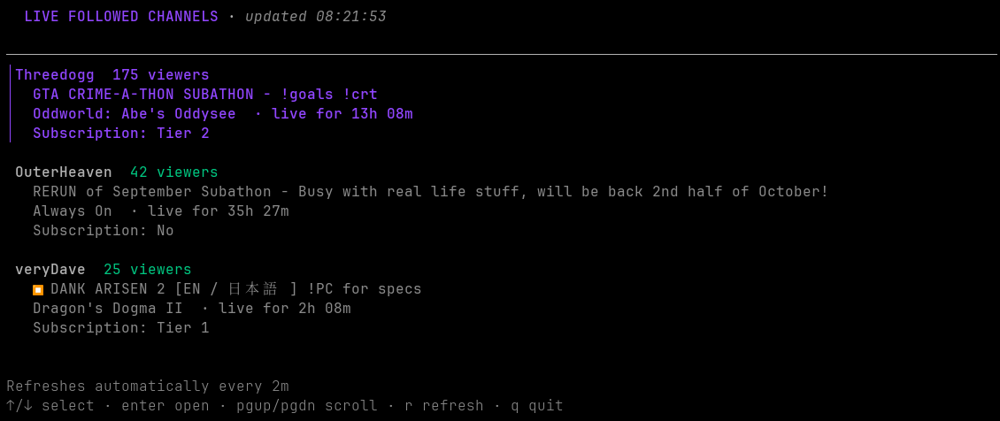
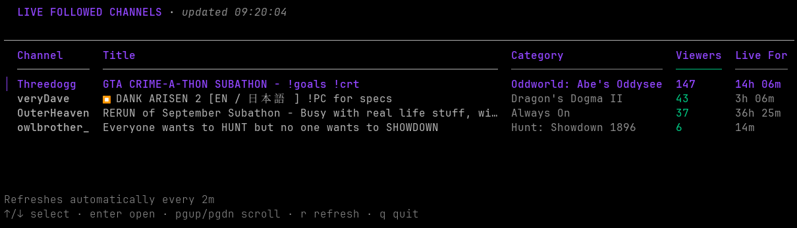

# TwitchLiveCLI

Monitor followed Twitch channels, open live streams, and get desktop notifications.

## Live screen examples

The live screen is available in card and table layouts.

**Card layout**



**Table layout**



## Contents

- [Live screen examples](#live-screen-examples)
- [Install](#install)
  - [Linux and macOS](#linux-and-macos)
  - [Windows](#windows)
  - [From source](#from-source)
- [Sign in and run](#sign-in-and-run)
  - [Use the live screen](#use-the-live-screen)
  - [Manage desktop notifications](#manage-desktop-notifications)
- [Commands](#commands)
- [Configuration](#configuration)
  - [Choose a config file](#choose-a-config-file)
  - [Set general preferences](#set-general-preferences)
  - [Set notification preferences](#set-notification-preferences)
- [Playback and chat](#playback-and-chat)
- [Credentials](#credentials)
- [Troubleshooting](#troubleshooting)
- [Development](#development)
  - [Charm libraries](#charm-libraries)

## Install

Requirements:

- Linux, macOS, or Windows on amd64 or arm64.
- Internet access and a Twitch account.
- An interactive terminal for the live screen and notification manager. Without one, the default command prints a single snapshot.

### Linux and macOS

Install the latest release with `curl`:

```sh
curl -fsSL https://raw.githubusercontent.com/thomasjdelaney/TwitchLiveCLI/master/install.sh | sh
```

Or use `wget`:

```sh
wget -qO- https://raw.githubusercontent.com/thomasjdelaney/TwitchLiveCLI/master/install.sh | sh
```

The installer puts the binary in `~/.local/bin`. Set `INSTALL_DIR` to choose another location:

```sh
curl -fsSL https://raw.githubusercontent.com/thomasjdelaney/TwitchLiveCLI/master/install.sh | INSTALL_DIR="$HOME/bin" sh
```

### Windows

Run this in PowerShell to install the latest release:

```powershell
$installer = Join-Path ([IO.Path]::GetTempPath()) "twitch-live-cli-install-$([guid]::NewGuid()).ps1"
try {
    Invoke-WebRequest https://raw.githubusercontent.com/thomasjdelaney/TwitchLiveCLI/master/install.ps1 -OutFile $installer -ErrorAction Stop
    & $installer
} finally {
    Remove-Item -LiteralPath $installer -Force -ErrorAction SilentlyContinue
}
```

It installs to `%LOCALAPPDATA%\Programs\twitch-live-cli` and adds that directory to your user `PATH`. Open a new terminal after installation. To choose another directory, run the downloaded script with `-InstallDir PATH`. The installer requires `tar.exe`.

### From source

With Go 1.26 or newer, clone the repository and install from its root:

```sh
git clone https://github.com/thomasjdelaney/TwitchLiveCLI.git
cd TwitchLiveCLI
go install .
```

## Sign in and run

1. Open a terminal and run:

```sh
twitch-live-cli
```

2. On first run, open the verification link, enter the displayed code, and approve access to your followed channels.

### Use the live screen

When started in an interactive terminal, the live screen refreshes every minute and sorts by viewer count, highest first. Use these keys to navigate:

| Action | Keys |
| --- | --- |
| Select a channel | Up: `↑` / `k`; down: `↓` / `j` |
| Open the selected channel | `Enter` |
| Refresh | `r` |
| Scroll a long list | `Home` / `End`, `PgUp` / `PgDn` |
| Quit | `q` |

Without an interactive terminal, `twitch-live-cli` prints one snapshot. Use `--once` to request a snapshot explicitly.

### Manage desktop notifications

1. Press `n` in the live screen, or run `twitch-live-cli notifications` in an interactive terminal.
2. Press `/` to filter followed channels by name or login. Type to edit; press `Enter` or `Esc` to finish. Use `↑` / `↓` to select a channel and `Space` or `Enter` to toggle its notifications. Changes are saved to the active config file.
3. Press `s` to toggle alerts for enabled channels that are already live when the live screen starts.

Notifications are off for all channels by default. They are delivered only while the regular live screen is running, when an enabled channel goes live. The startup alert is optional.

## Commands

| Example | Purpose |
| --- | --- |
| `twitch-live-cli --once` | Print one snapshot in any terminal. |
| `twitch-live-cli --json` | Print live channels as JSON. |
| `twitch-live-cli --display card` | Show cards instead of the default table. |
| `twitch-live-cli --sort-by channel --sort-order asc` | Sort alphabetically. |
| `twitch-live-cli --subscriptions` | Include subscription status and tier. |
| `twitch-live-cli --refresh-interval 2m` | Set the live screen refresh interval (minimum `2s`). |
| `twitch-live-cli --open twitchdev` | Open a followed channel if it is live. |
| `twitch-live-cli notifications` | Manage desktop notification preferences (requires an interactive terminal). |
| `twitch-live-cli --logout` | Remove saved Twitch credentials. |
| `twitch-live-cli --version` | Show the installed version. |
| `twitch-live-cli --update` | Update to the latest release. The executable's directory must be writable; on Windows, the update completes after exit. |
| `twitch-live-cli --no-store` | Keep credentials only for the current run. |
| `twitch-live-cli --help` | List all options. |

Sort fields: `viewers`, `channel`, `title`, `category`, `live_duration`, `subscribed`, and `sub_tier`. Text fields default to ascending order; other fields default to descending. Subscription sorting requires `--subscriptions`. `--json` cannot be combined with `--display`; `--open` selects a channel to launch and cannot be combined with `--once`, `--json`, or `--display`.

## Configuration

### Choose a config file

By default, preferences are read from `twitch-live-cli/config.toml` in your operating system's user config directory. To use a different file, pass `--config`:

```sh
twitch-live-cli --config ./config.toml
```

The notification manager accepts the same option:

```sh
twitch-live-cli notifications --config ./config.toml
```

For settings that have command-line options, command-line values override the config file, which overrides defaults.

### Set general preferences

Add the settings you want to `config.toml`:

```toml
display = "card"
sort_by = "channel"
sort_order = "asc"
refresh_interval = "2m"
subscriptions = false
viewer = "browser"
player = "mpv"
quality = "middle"
chat = false
low_latency = false
```

Use this table to choose values:

| Setting | Values and defaults |
| --- | --- |
| `display` | `table` (default) or `card` |
| `sort_by` | `viewers` (default), `channel`, `title`, `category`, `live_duration`, `subscribed`, or `sub_tier` |
| `sort_order` | `asc` or `desc`; defaults to ascending for text fields and descending otherwise |
| `refresh_interval` | Duration of at least `2s`; default `1m`. Applies to the interactive screen. |
| `subscriptions` | `true` or `false` (default: `false`). Required to sort by `subscribed` or `sub_tier`. |
| `viewer` | `browser` (default) or `streamlink` |
| `player` | `mpv` (default) or `vlc`; used with Streamlink |
| `quality` | Streamlink quality name; default `middle` |
| `chat` | `true` or `false` (default: `false`); opens Chatterino with the stream |
| `low_latency` | `true` or `false` (default: `false`); requires `viewer = "streamlink"` |

Boolean command-line options can override `true` values with `=false`, for example `--chat=false` or `--subscriptions=false`.

### Set notification preferences

The notification manager saves changes automatically. You can also edit these settings in TOML:

```toml
# Followed-channel broadcaster IDs to notify for.
notification_channels = ["12345678", "87654321"]
# Also notify for enabled channels already live when the live screen starts.
notify_on_startup = false
```

`notification_channels` is empty by default and accepts broadcaster IDs for channels you follow. `notify_on_startup` defaults to `false`. Desktop notification display and dismissal are controlled by the operating system.

## Playback and chat

- The default viewer opens streams in your browser.
- Streamlink playback requires [Streamlink](https://streamlink.github.io/) and mpv or VLC on your `PATH`.
- Choose a player or quality with `--player vlc` and `--quality 720p60`.
- `--low-latency` enables Streamlink's Twitch low-latency mode; set `--viewer streamlink` to use it.
- `--chat` opens [Chatterino](https://chatterino.com/) alongside the stream. Both tools must be on your `PATH`.
- Opening links uses `open` (macOS), `rundll32` (Windows), or `xdg-open` (Linux). Linux may require `xdg-utils`.

## Credentials

The CLI uses Twitch Device Code Grant. It stores credentials in the system credential store: Keychain on macOS, Credential Manager on Windows, or a Secret Service keyring on Linux. Use `--no-store` to keep credentials only for the current process, or `--logout` to remove saved credentials.

Subscription details are off by default. Enabling `--subscriptions` requests Twitch's `user:read:subscriptions` permission in addition to `user:read:follows`.

## Troubleshooting

- **Sign-in page did not open:** open the verification link yourself and enter the displayed code.
- **Credential store unavailable:** unlock or install your system keyring, or run with `--no-store`.
- **Follows permission missing:** run `twitch-live-cli --logout`, then sign in again.
- **Subscription lookup fails:** confirm your account can check subscriptions and approve the requested permission.
- **Rate limit:** wait until the reset time in the error message, then retry.

For other problems or bug reports, [open an issue](https://github.com/thomasjdelaney/TwitchLiveCLI/issues).

## Development

- Requires Go 1.26 or newer.
- Run checks from the repository root: `go test ./...` and `go build -buildvcs=false ./...`.
- GitHub Actions tests on Linux, Windows, and macOS. Version tags (`v*`) build release archives for amd64 and arm64 on all three platforms.
- See [CI investigation notes](docs/ci-investigation.md) for the Windows test startup investigation.
- To use your own Twitch application, set `TWITCH_CLIENT_ID` or pass `--client-id ID`. It must support public-client Device Code Grant. Never add a client secret to the CLI.
- Authentication diagnostics are suppressed in the live screen and snapshot output (`--once`, `--json`, and noninteractive runs). To capture them, run `twitch-live-cli --auth-log ./auth.log`; new messages are appended to the file.

### Charm libraries

The terminal UI is built with libraries from [Charm](https://charm.land/):

- [Bubble Tea v2](https://github.com/charmbracelet/bubbletea) manages the UI event loop and rendering.
- [Bubbles v2](https://github.com/charmbracelet/bubbles) provides the loading spinner and notification filter input.
- [Lip Gloss v2](https://github.com/charmbracelet/lipgloss) handles styling and layout.
- [`x/ansi`](https://github.com/charmbracelet/x/tree/main/ansi) provides ANSI-aware text width and truncation.
- [`x/term`](https://github.com/charmbracelet/x/tree/main/term) provides terminal sizing and detection.
